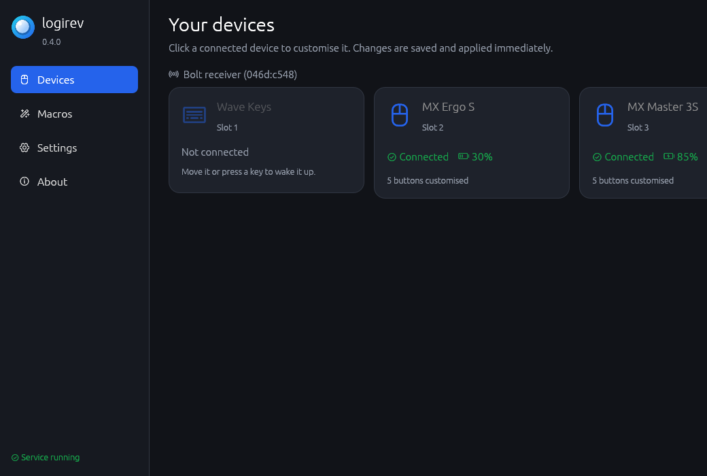
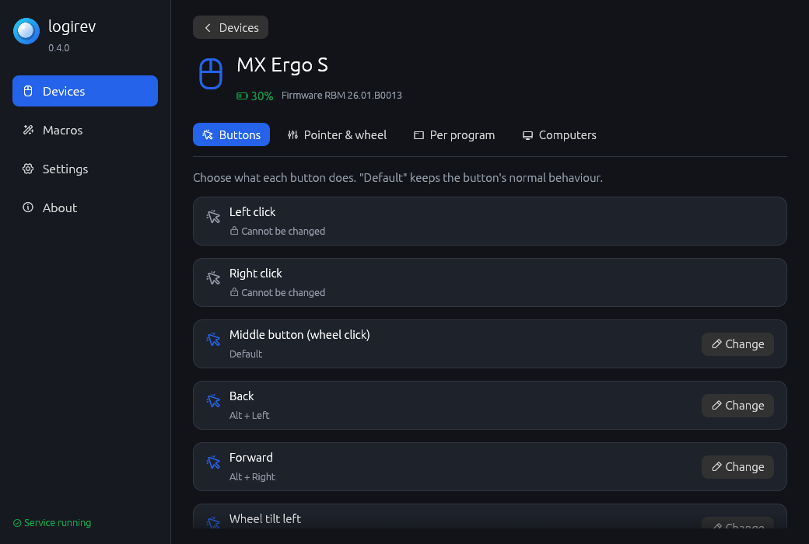
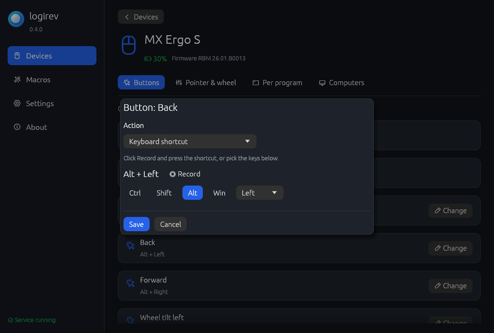
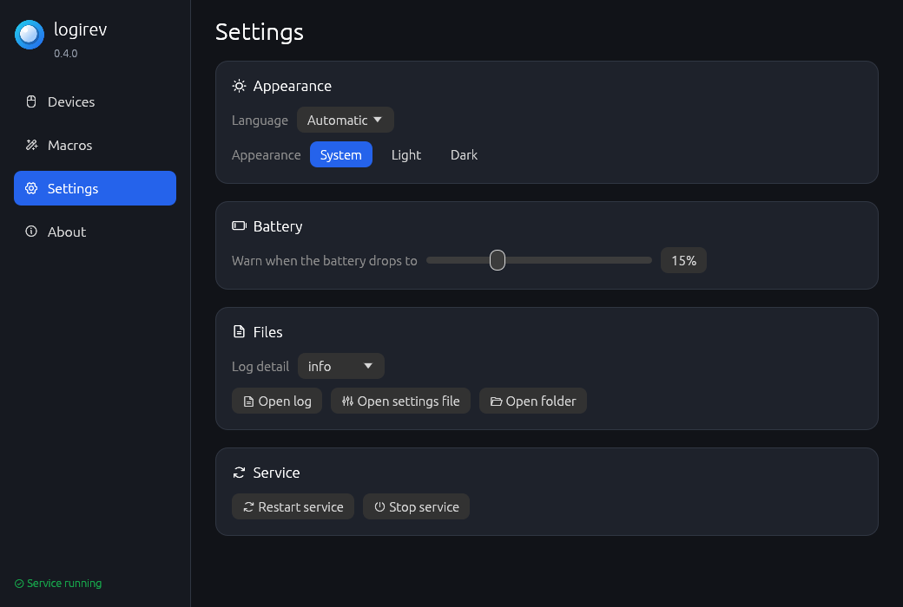
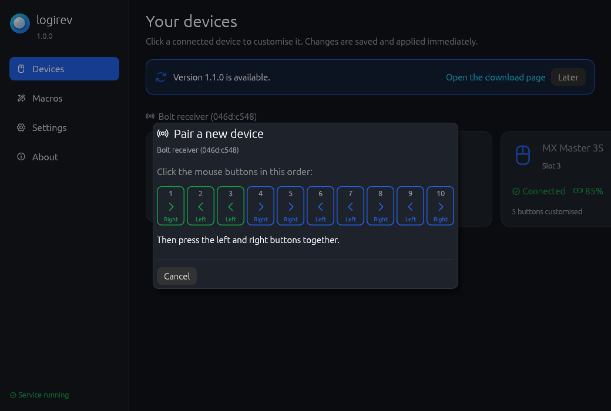

# logirev

**Set up your Logitech mouse, trackball or keyboard — without Logi
Options+.** A small, portable app: unzip it, double-click it, done.



It works with devices connected through a **Logi Bolt** or **Unifying**
receiver (the small USB "dongle") and with devices connected directly by
cable or Bluetooth. It was built and tested with an **MX Ergo S** trackball.

## What it does

- **Choose what every button does** — keyboard shortcuts (just press them to
  record), mouse clicks, scrolling, opening programs, macros, gestures (hold
  a button and move), screen brightness, keyboard backlight, switching to
  another computer.
- **Different buttons in different programs** — e.g. the side buttons do
  *undo / redo* only in Photoshop.
- **Speed and wheel** — DPI, precision mode, SmartShift, scroll direction.
- **Keyboards** — F-keys or media keys, disable Caps Lock & co., backlight.
- **Easy-Switch** — send a device (or all of them together) to another
  computer, from the app or with a button.
- **Pair and remove devices** — connect a new mouse or keyboard to your
  Bolt or Unifying receiver right from the app (no Logi Options+, no web
  page), or free a slot.
- **Battery at a glance**, and a **notification when it gets low**.
- **Plug & play** — devices are set up the moment they connect or wake up.
- **Light** — the background part uses just a few MB of memory and no
  CPU while idle; the window only runs while it is open.
- **Updates itself** — when a new version is out, one click installs it.
- **Portable and private** — no installation, no account, no telemetry.
  The only time it goes online is the update check (once a day, nothing
  about you is sent; it can be turned off). Works from a USB stick. English
  and Italian.

| Customise a device | Change a button |
|---|---|
|  |  |

---

## Contents

1. [Getting started on Windows](#getting-started-on-windows)
2. [Using the app](#using-the-app)
3. [Pairing a new device](#pairing-a-new-device)
4. [Questions and answers](#questions-and-answers)
5. [When something does not work](#when-something-does-not-work)
6. [Linux](#linux)
7. [More documentation](#more-documentation)
8. [License](#license)

---

## Getting started on Windows

1. **Download** `logirev-<version>-windows-x64.zip` from the **Releases**
   page of this repository and unzip it into a folder that will stay where
   it is, for example `C:\Tools\logirev\`.
2. **Quit Logi Options+** if you have it (right-click its icon next to the
   clock → *Quit*): two programs cannot control the same device.
3. **Double-click `logirev.exe`.** The logirev window opens and shows your
   devices. A blue round icon also appears next to the clock: that is the
   part that keeps your devices set up in the background.

That's it. To make it start by itself every time you turn the computer on,
open *Settings* in the app and tick **Start with Windows**.

> If you don't see the icon next to the clock, click the `^` arrow there:
> Windows may have tucked it away. You can drag it next to the clock.

---

## Using the app

Open it with a **left-click on the icon** next to the clock (or by
double-clicking `logirev.exe` again).

- **Devices** — all devices paired with your receivers (up to 6 per
  receiver), with battery and status. Click a connected one to customise it:
  - **Buttons**: click *Change* next to a button and pick an action. For a
    shortcut, click *Record* and press it.
  - **Pointer & wheel**: speed (DPI) and wheel options.
  - **Keyboard**: F-keys, keys to disable, backlight.
  - **Per program**: add a program (or pick one that is running) and give
    buttons a different job while it is in front.
  - **Computers**: send the device to another computer (Easy-Switch).
- **Macros** — lists of steps (shortcuts, text, clicks, pauses) that a
  button can run.
- **Settings** — language, light or dark look, *Start with Windows*,
  battery warning, **updates**.

**Updates:** logirev looks for a new version once a day. When there is one,
a notification appears and the app shows *Version X is available* with an
**Update now** button: logirev downloads the new version from this
project's GitHub page, checks that the files are intact, replaces itself and
restarts — your settings stay as they are. You can turn the check off, or
check by hand, in *Settings → Updates*.

Changes are **saved and applied immediately**; there is no "save" button.
Closing the window does not stop logirev: the icon next to the clock keeps
working. Right-click it for more options, including *Quit*.

| | |
|---|---|
|  | Everything is also stored in a plain text file, `logirev.toml`, next to the program. You never need to open it, but you can: see [docs/CONFIGURATION.md](docs/CONFIGURATION.md). |

---

## Pairing a new device

A Bolt or Unifying receiver can hold up to **6** devices. To add one:

1. Open the app. Next to your receiver, click **Pair a new device**.
2. Put the new device in pairing mode:
   - **Bolt:** press and hold its connect / Easy-Switch button until the
     light blinks fast. The device appears in the list: click **Pair**.
   - **Unifying:** just turn it on (or press its connect button).
3. **Bolt only — prove it is yours** (so nobody nearby can pair their
   device with your receiver):
   - **keyboard:** type the 6-digit code shown and press Enter;
   - **mouse / trackball:** click the buttons in the order shown (left,
     right, ...), then press left and right together.

   
4. Done: the device appears in the list and is set up immediately.

**Removing a device:** right-click its card (or open it) and choose
**Remove pairing**. The device stops working with this receiver until you
pair it again — useful to free a slot or to clean up duplicates.

From the command line: `logirevctl pair` and `logirevctl unpair <slot>`
(the slot numbers are shown by `logirevctl scan`).

> Lightspeed (gaming) receivers are paired at the factory and cannot pair
> other devices.

---

## Questions and answers

**Why must logirev keep running? Can't the settings be saved in the device?**
Most office devices (MX Ergo S included) have no memory for your
preferences: each time they sleep or are switched off they return to factory
behaviour. logirev notices when the device comes back and sends the settings
again, within a fraction of a second. Logi Options+ does exactly the same.

**Does it slow my computer down?** No. The background part sleeps until a
device sends something and uses just a few MB of memory.

**How many devices can I use?** Up to 6 per receiver, and several receivers
at once.

**What happens when I quit logirev?** Your devices go back to their normal
behaviour.

**Is it safe?** logirev only changes temporary settings. It never writes to
the device's permanent memory or firmware: switching the device off always
brings back the factory behaviour.

**How does it work?** In plain words, with real examples:
[docs/PROTOCOL.md](docs/PROTOCOL.md).

---

## When something does not work

| What you see | What to do |
|---|---|
| The app says *Service not running* | Click *Start*. If it stops again, see the log (*Settings → Open log*). |
| *No receiver found* | Is the receiver plugged in? Quit Logi Options+ and try again. |
| A device shows *Not connected* | It is asleep: move it or press a key. |
| A button is marked *Cannot be changed* | The device does not allow changing that button. |
| A shortcut does not reach a program | Windows blocks simulated keys in programs started "as administrator", unless logirev is started as administrator too. |
| The screen brightness action does nothing | Enable "DDC/CI" in your monitor's on-screen menu. |

To report a problem, attach `logirev.log` (*Settings → Open log*). For
advanced diagnostics there is `logirevctl.exe`, a command-line tool:
`logirevctl scan` lists everything the devices report, and
`logirevctl run --log-level debug --pcap logirev.pcap` records the traffic
for Wireshark (quit logirev first).

**Developer mode** (*Settings → Developer mode*) adds a *Technical* tab to
each device: serial number, firmware components, every feature (including
the ones Logitech keeps hidden) and the HID++ messages as they happen, with
a *Copy report* button for bug reports. Everything there is read-only.

---

## Linux

The Linux download runs the background service without a window (the app
window can be built from source with `cargo build --release`).

1. Unpack the archive and open a terminal in that folder.
2. Allow your user to talk to the receiver and to simulate key presses:

   ```bash
   sudo cp tools/42-logirev.rules /etc/udev/rules.d/
   sudo udevadm control --reload && sudo udevadm trigger
   ```

   For the brightness action on laptops also run
   `sudo usermod -aG video $USER`. Unplug and re-plug the receiver, then log
   out and back in.
3. Quit Solaar if it is running, then look at your devices: `./logirevctl scan`
4. Create the settings file and start at every log-in:

   ```bash
   ./logirevctl init
   ./logirevctl install-service
   systemctl --user daemon-reload && systemctl --user enable --now logirev.service
   ```

   Settings are edited in `logirev.toml` (see
   [docs/CONFIGURATION.md](docs/CONFIGURATION.md)) and applied as soon as
   the file is saved.

---

## More documentation

| Document | For whom |
|---|---|
| [Code documentation](https://wildzer0.github.io/logirev/) | developers: every module and function, generated with `cargo doc` |
| [docs/CONFIGURATION.md](docs/CONFIGURATION.md) | the settings file, every option explained |
| [docs/PROTOCOL.md](docs/PROTOCOL.md) | the curious: how logirev talks to the device |
| [docs/DEVELOPMENT.md](docs/DEVELOPMENT.md) | developers: building, code layout, releasing |
| [docs/TESTING.md](docs/TESTING.md) | testers: the checklist used before each release |
| [CHANGELOG.md](CHANGELOG.md) | what changed in each version |

---

## License

logirev is free for **personal and non-commercial use**: you may use it,
study it, change it and share it, as long as it is not for a commercial
purpose. Charities, schools, research and public institutions may use it too.
See [LICENSE.md](LICENSE.md) (PolyForm Noncommercial 1.0.0) for the exact
terms. Icons: [Phosphor Icons](https://phosphoricons.com) (MIT).

logirev is an independent project, not affiliated with or endorsed by
Logitech. "Logitech", "Logi", "Bolt", "Unifying" and "MX" are trademarks of
Logitech.
